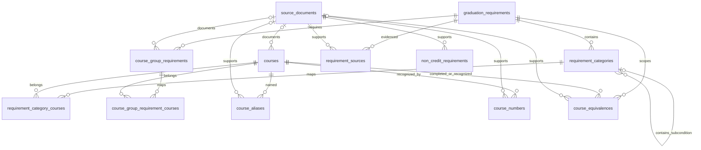

# DB 스키마와 백엔드 조회 계약

## 관계도

`course_equivalences`는 실제 이수 과목과 인정 대상 과목이라는 두 외래키로 courses에 연결한다.
방향성을 가지며 졸업요건 범위별로 적용한다. 같은 규칙을 역방향으로 자동 생성하지 않는다.
`non_credit_requirements`는 입학년도·세부전공으로 적용하며 프로그램별로 중복 저장하지 않는다.
학생 계정·PDF 원본·학생 개인의 이수내역은 이 스키마에 저장하지 않는다.

## 조회 계약

백엔드는 `app.services.rule_repository.get_rule_bundle(session, admission_year, program, sub_major)`를
사용할 수 있다. 세션 수명은 호출자가 관리한다. program은 engineering/general,
sub_major는 software/ai를 사용하여 기존 API 명세의 공통 값과 맞춘다.

- 공학 선택: 공학·일반 규칙을 이 순서로 반환한다.
- 일반 선택: 일반 규칙만 반환한다.
- 인공지능 세부전공필수 그룹과 졸업논문·TOPCIT는 공통 목록에 한 번만 반환한다.
- 없는 학번이나 필수 규칙은 LookupError로 알린다. 다른 학번의 규칙을 대신 쓰지 않는다.
- 잘못된 프로그램·세부전공 값은 ValueError로 알린다.
- 공통 과목 그룹이 프로그램별로 다르면 LookupError로 알린다.
- 미확인 학수번호는 null을 유지하며, 과목 후보를 임의로 확정하지 않는다.
- 과목 매칭용 번호는 `course_numbers`([과목번호](#과목번호))에 있고, 이 조회 결과의 `course_code`와 무관하다.

이 결과는 DB 조회 계약이다. API 응답 변환·학점 합산·이수과목 판정은 별도 백엔드 로직이다.
총학점, 공학주제 및 설계는 중첩되는 요건이다. 영역별 요구량을 전부 합산하지 않는다.
parent_category_id는 수학·과학과 기초교양, 설계와 공학주제의 포함 관계를 저장한다.
시드와 조회 코드는 같은 졸업요건 범위 내의 부모만 허용한다.
미확인 과목 학점은 null을 유지한다. 0으로 바꾸거나 학점 충족으로 처리하지 않는다.
현재 반환하는 `data_complete`는 false이며 미완성 목록이 `pending_data`에 있다.
조회 성공을 최종 졸업 판정 가능 상태로 해석하지 않는다.

공식 자료 출처와 검증 범위는 [데이터 검증 기록](data-verification.md),
실행 방법은 [DB 개발 가이드](db-setup.md)를 따른다.

별칭·대체 인정은 source_id로 출처를 연결한다. NULL은 근거 미확인이며 공식 인정에 사용하지 않는다.
과목 시드는 학과+과목명으로 후보를 찾는 공통 함수를 사용한다. 출처는 식별 키가 아니다.
캡스톤 택1 그룹은 공학프로그램 졸업요건에만 연결한다. 일반프로그램의 캡스톤설계 심사는
공통 비학점 요건 thesis로 다루며, 근거는 일반 졸업요건의 requirement_sources(이수내규)에 남긴다.
상세는 [데이터 검증 기록](data-verification.md)의 「캡스톤 적용 범위 재검토」 절을 따른다.

## 과목번호

`course_numbers`는 과목이 인정하는 4자리 과목번호를 과목당 여러 개 저장한다. KLAS 학정번호
`학과코드-난이도-과목번호-분반`(예: `I030-1-0019-02`)의 가운데 4자리이며 매칭 방식은 [과목 매칭](course-matching.md)을 따른다.

| 컬럼 | 설명 |
| --- | --- |
| `course_number_id` | PK |
| `course_id` | `courses` FK |
| `course_number` | 영숫자 4자리(CHECK `^[0-9A-Za-z]{4}$`), 앞자리 0 보존, 대소문자 구분, 테이블 전체에서 UNIQUE |
| `source_id` | `source_documents` FK, NOT NULL |
| `review_status` | `pending`(기본)·`verified`·`needs_clarification`·`rejected` |
| `reviewer`, `reviewed_on`, `note` | `verified`이면 확인자·확인일 필수(`requirement_sources`와 같은 규칙) |

- 같은 번호가 두 과목에 걸리면 매칭이 모호해지므로 번호는 전체에서 UNIQUE다. pending·rejected 행도 번호를 점유하므로
  충돌은 입력 시점에 드러난다. 실제 자료에서 한 번호가 정당하게 둘 이상의 과목에 걸리는 것이 확인되면 그때 제약을 바꾼다.
- 카탈로그 스냅샷에는 `verified` 번호만 싣는다. `SourceDocument` 연결만으로 검증된 것으로 보지 않는다.
- `courses.course_code`(과목당 1개, UNIQUE)는 매칭에 쓰지 않는다. 한 과목의 여러 번호와 학과코드·분반 차이를 담을 수 없고
  검증 기록도 없다. 시드·조회 계약(`rule_repository`의 `course_code`)이 쓰고 있어 컬럼은 유지하며, 새 번호는 `course_numbers`에만 넣는다.
- 학과코드로 인정 범위를 제한하지 않는다.
