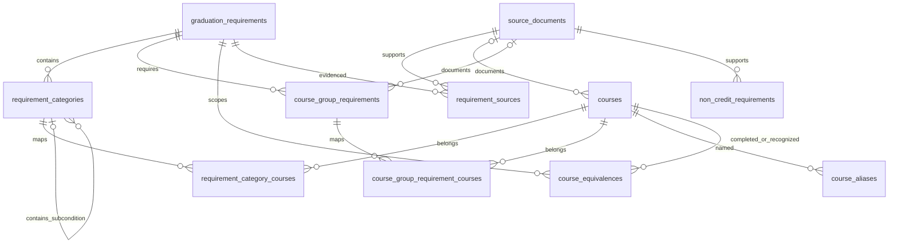

# DB 스키마와 백엔드 조회 계약

## 관계도

`course_equivalences`는 실제 이수 과목과 인정 대상 과목이라는 두 외래키로 courses에 연결한다.
방향성을 가지며 졸업요건 범위별로 적용한다. 같은 규칙을 역방향으로 자동 생성하지 않는다.
`non_credit_requirements`는 입학년도·세부전공으로 적용하며 프로그램별로 중복 저장하지 않는다.
학생 계정·PDF 원본·학생 개인의 이수내역은 이 스키마에 저장하지 않는다.

## 조회 계약

백엔드는 `app.services.rule_repository.get_rule_bundle(session, admission_year, program, sub_major)`를
사용할 수 있다. 세션 수명은 호출자가 관리한다. program은 engineering/general,
sub_major는 software/ai를 사용하여 기존 API 명세의 공통 값과 맞춘다.

- 공학 선택: 공학·일반 규칙을 이 순서로 반환한다.
- 일반 선택: 일반 규칙만 반환한다.
- 인공지능 세부전공필수 그룹과 졸업논문·TOPCIT는 공통 목록에 한 번만 반환한다.
- 없는 학번이나 필수 규칙은 LookupError로 알린다. 다른 학번의 규칙을 대신 쓰지 않는다.
- 잘못된 프로그램·세부전공 값은 ValueError로 알린다.
- 공통 과목 그룹이 프로그램별로 다르면 LookupError로 알린다.
- 미확인 학수번호는 null을 유지하며, 과목 후보를 임의로 확정하지 않는다.

이 결과는 DB 조회 계약이다. API 응답 변환·학점 합산·이수과목 판정은 별도 백엔드 로직이다.
총학점, 공학주제 및 설계는 중첩되는 요건이다. 영역별 요구량을 전부 합산하지 않는다.
parent_category_id는 수학·과학과 기초교양, 설계와 공학주제의 포함 관계를 저장한다.
시드와 조회 코드는 같은 졸업요건 범위 내의 부모만 허용한다.
미확인 과목 학점은 null을 유지한다. 0으로 바꾸거나 학점 충족으로 처리하지 않는다.
현재 반환하는 `data_complete`는 false이며 미완성 목록이 `pending_data`에 있다.
조회 성공을 최종 졸업 판정 가능 상태로 해석하지 않는다.

공식 자료 출처와 검증 범위는 [데이터 검증 기록](data-verification.md),
실행 방법은 [DB 개발 가이드](db-setup.md)를 따른다.
